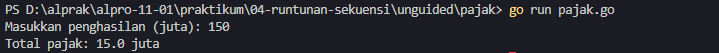

# <h1 align="center">Laporan Praktikum Modul 04 - Runtunan atau Sekuensi</h1>
<p align="center">Mirza Ukail Falah Triyarso - 109092600006</p>

## Dasar Teori

### Pengertian Runtunan (Sequence)
Dalam konsep dasar pemrograman, **Runtunan** atau **Sekuensi** merujuk pada eksekusi instruksi secara berurutan langkah demi langkah. 

Secara default, baris kode yang dituliskan dalam suatu program akan diproses oleh komputer dari urutan paling atas ke bawah, serta dari kiri ke kanan. Pemahaman mengenai alur sekuensi sangat krusial, sebab kesalahan penempatan posisi variabel atau instruksi dapat menyebabkan program gagal melakukan kompilasi (*compile error*) atau menghasilkan luaran yang tidak sesuai logisnya (*logic error*).

#### Contoh Sekuensi yang Benar:
```go
package main
import "fmt"

func main() {
	nama := "Luhab Maulana"
	nim := "123454545009"
	jurusan := "S1 Informatika"
	
	fmt.Println("=== BIODATA MAHASISWA ===")
	fmt.Println("Nama :", nama)
	fmt.Println("NIM :", nim)
	fmt.Println("Jurusan :", jurusan)
}
```
Apabila kode di atas dijalankan, sistem membaca deklarasi variabel terlebih dahulu sebelum menampilkan nilainya. Keluaran program:
```text
=== BIODATA MAHASISWA ===
Nama : Luhab Maulana
NIM : 123454545009
Jurusan : S1 Informatika
```

#### Contoh Kesalahan Urutan Eksekusi:
```go
package main
import "fmt"

func main() { 
	fmt.Println("=== BIODATA MAHASISWA ===")
	fmt.Println("Nama :", nama)
	fmt.Println("NIM :", nim)
	fmt.Println("Jurusan :", jurusan)

	nama := "Luhab Maulana"
	nim := "123454545009"
	jurusan := "S1 Informatika"
}
```
Jika struktur kode diubah seperti di atas, **program tidak akan dapat dikompilasi**. Komputer membaca baris `fmt.Println` lebih dulu saat variabel `nama`, `nim`, dan `jurusan` belum diperkenalkan/dideklarasikan dalam memori.

*Compiler* Go akan menampilkan *error* seperti berikut:
- `undefined: nama`
- `undefined: nim`
- `undefined: jurusan`

Hal ini membuktikan bahwa urutan penulisan kode sangat menentukan keberhasilan eksekusi program.

---

## Guided

### 1. grade.go

```go
package main

import (
	"bufio"
	"fmt"
	"os"
)

func main() {
	var (
		nilai float64
		nama, grade string
	)
	// Inisialisasi scanner untuk pembacaan input teks
	scanner := bufio.NewScanner(os.Stdin)
	
	fmt.Println("Masukkan nama: ")
	scanner.Scan()
	nama = scanner.Text()

	fmt.Println("Masukkan nilai: ")
	fmt.Scan(&nilai)

	if nilai >= 90 && nilai <= 100 {
		grade = "A"
	} else if nilai >= 80 && nilai < 90 {
		grade = "B"
	} else if nilai >= 70 && nilai < 80 {
		grade = "C"
	} else if nilai >= 60 && nilai < 70 {
		grade = "D"
	} else {
		grade = "E"
	}

	fmt.Println(nama)
	fmt.Println(grade)
}
```

#### Penjelasan Program
Program `grade.go` dirancang untuk mengonversi nilai angka siswa ke dalam predikat huruf (*grade*) berdasarkan skala penilaian tertentu.

1. **Input Data**:
   Menggunakan pustaka `bufio.Scanner` agar input nama dapat menerima teks bersepasi (lebih dari satu kata). Kemudian, `fmt.Scan` digunakan untuk menerima angka pecahan (`float64`).
   ```go
   scanner := bufio.NewScanner(os.Stdin)
   scanner.Scan()
   nama = scanner.Text()
   fmt.Scan(&nilai)
   ```

2. **Pengondisian (Branching)**:
   Program menyeleksi rentang nilai menggunakan struktur `if - else if - else`:
   - **Grade A**: Nilai $90 \le \text{nilai} \le 100$
   - **Grade B**: Nilai $80 \le \text{nilai} < 90$
   - **Grade C**: Nilai $70 \le \text{nilai} < 80$
   - **Grade D**: Nilai $60 \le \text{nilai} < 70$
   - **Grade E**: Nilai di bawah $60$

3. **Output**:
   Menampilkan nama beserta hasil predikat huruf yang diperoleh.

#### Contoh Uji Coba (Input & Output)
**Input:**
```text
Mirza Ukail Falah Triyarso
95
```
**Output:**
```text
Mirza Ukail Falah Triyarso
A
```

---

### 2. penilaian.go

```go
package main

import (
	"bufio"
	"fmt"
	"os"
)

func main() {
	var (
		nama, grade   string
		nilai, pilihan int
	)

	fmt.Println("============= Menu =============")
	fmt.Println("1. Sistem penilaian")
	fmt.Println("0. Keluar")
	fmt.Print("Pilih opsi: ")
	fmt.Scanln(&pilihan)

	if pilihan == 1 {
		fmt.Print("Masukkan Nama:")
		scanner := bufio.NewScanner(os.Stdin)
		scanner.Scan()
		nama = scanner.Text()

		fmt.Print("Masukkan Nilai:")
		fmt.Scan(&nilai)

		if nilai >= 90 && nilai <= 100 {
			grade = "A"
		} else if nilai >= 80 && nilai < 90 {
			grade = "B"
		} else if nilai >= 70 && nilai < 80 {
			grade = "C"
		} else if nilai >= 60 && nilai < 70 {
			grade = "D"
		} else {
			grade = "E"
		}

		fmt.Println(nama)
		fmt.Println(grade)

	} else if pilihan == 0 {
		return
	} else {
		fmt.Println("Pilihan tidak valid")
	}
}
```

#### Penjelasan Program
Program `penilaian.go` mengintegrasikan fitur pengolah nilai ke dalam sistem antarmuka berbasis menu interaktif.

1. **Sistem Navigasi Menu**:
   Pengguna diminta memilih opsi awal melalui input `pilihan`:
   - Opsional `1`: Melanjutkan ke proses perhitungan penilaian.
   - Opsional `0`: Menghentikan eksekusi program (`return`).
   - Opsi Lainnya: Menampilkan pesan kesalahan `"Pilihan tidak valid"`.

2. **Proses Evaluasi Nilai**:
   Apabila opsi `1` dipilih, program membaca input nama dan nilai (bertipe `int`), kemudian mencocokkan nilai tersebut ke standar skala predikat A hingga E.

#### Contoh Uji Coba (Input & Output)
**Input:**
```text
Pilih opsi: 1
Masukkan Nama: Saddam
Masukkan Nilai: 56
```
**Output:**
```text
Saddam
E
```

---

### 3. klasifikasi.go

```go
package main

import "fmt"

func main() {
	var (
		usia, gajiTahunan int
	)

	fmt.Print("Masukkan usia: ")
	fmt.Scan(&usia)

	fmt.Print("Masukkan gaji tahunan (juta): ")
	fmt.Scan(&gajiTahunan)

	switch {
	case usia < 18 && gajiTahunan == 0:
		fmt.Println("Masih Sekolah")
	case (usia >= 18 && usia <= 25) && gajiTahunan >= 50:
		fmt.Println("Muda Sukses")
	case (usia >= 18 && usia <= 25) && gajiTahunan < 50:
		fmt.Println("Masih belajar hidup")
	case (usia >= 26 && usia <= 40) && gajiTahunan >= 100:
		fmt.Println("Pekerja Mapan")
	case (usia >= 26 && usia <= 40) && gajiTahunan < 100:
		fmt.Println("Perlu perbaikan karir")
	case usia > 40 && gajiTahunan >= 150:
		fmt.Println("Profesional Berpengalaman")
	case usia > 40 && gajiTahunan < 150:
		fmt.Println("Perlu Evaluasi Finansial")
	}
}
```

#### Penjelasan Program
Program `klasifikasi.go` memetakan profil finansial dan status sosial seseorang berdasarkan kombinasi antara kriteria `usia` dan total `gajiTahunan` (dalam satuan juta). Berbeda dari dua program sebelumnya yang menggunakan percabangan `if-else`, program ini memanfaatkan konstruksi `switch` tanpa kondisi (*tagless switch*).

Kondisi yang dievaluasi mencakup:
- **Masih Sekolah**: Usia $< 18$ tahun dan belum memiliki penghasilan ($0$).
- **Muda Sukses**: Usia $18 - 25$ tahun dengan gaji tahunan $\ge 50$ juta.
- **Masih belajar hidup**: Usia $18 - 25$ tahun dengan gaji tahunan $< 50$ juta.
- **Pekerja Mapan**: Usia $26 - 40$ tahun dengan gaji tahunan $\ge 100$ juta.
- **Perlu perbaikan karir**: Usia $26 - 40$ tahun dengan gaji tahunan $< 100$ juta.
- **Profesional Berpengalaman**: Usia $> 40$ tahun dengan gaji tahunan $\ge 150$ juta.
- **Perlu Evaluasi Finansial**: Usia $> 40$ tahun dengan gaji tahunan $< 150$ juta.

#### Contoh Uji Coba (Input & Output)
**Input:**
```text
Masukkan usia: 21
Masukkan gaji tahunan (juta): 52
```
**Output:**
```text
Muda Sukses
```

## Unguided

### 1. grade.go

```go
package main

import (
	"bufio"
	"fmt"
	"os"
)

func main() {
	var (
		nilai float64
		nama, grade string
	)
	// bufio scanner untuk input
	scanner := bufio.NewScanner(os.Stdin)

	fmt.Println("Masukkan nama: ")
	scanner.Scan()
	nama = scanner.Text()

	fmt.Println("Masukkan nilai: ")
	fmt.Scan(&nilai)

	if nilai >= 90 && nilai <= 100 {
		grade = "A"
	} else if nilai >= 80 && nilai < 90 {
		grade = "B"
	} else if nilai >= 70 && nilai < 80 {
		grade = "C"
	} else if nilai >= 60 && nilai < 70 {
		grade = "D"
	} else {
		grade = "E"
	}

	fmt.Println(nama)
	fmt.Println(grade)
}
```

#### Output


#### Deskripsi
Program `grade.go` dibuat untuk menentukan predikat (*grade*) akademik siswa berdasarkan skor akhir yang diinputkan. Program menerima dua jenis masukan: string untuk nama siswa (dibaca menggunakan `bufio.Scanner` agar mendukung nama yang terdiri dari beberapa kata) serta angka desimal (`float64`) untuk variabel `nilai`.

Proses evaluasi nilai dilakukan dengan pendekatan pengkondisian bercabang (`if-else if-else`) sebagai berikut:
- Nilai antara **90 hingga 100** mendapatkan grade **A**.
- Nilai antara **80 hingga kurang dari 90** mendapatkan grade **B**.
- Nilai antara **70 hingga kurang dari 80** mendapatkan grade **C**.
- Nilai antara **60 hingga kurang dari 70** mendapatkan grade **D**.
- Nilai di bawah **60** secara otomatis dikategorikan ke dalam grade **E**.

Setelah penentuan grade selesai, program mencetak nama siswa diikuti dengan predikat nilai yang diperoleh secara berurutan.

---

### 2. pajak.go

```go
package main

import "fmt"

func main() {
	var (
		penghasilan, pajak float64
	)

	// Persents
	p5 := 5.0 / 100.0
	p10 := 10.0 / 100.0
	p15 := 15.0 / 100.0
	p20 := 20.0 / 100.0

	fmt.Print("Masukkan penghasilan (juta): ")
	fmt.Scan(&penghasilan)

	switch {
	case penghasilan <= 50:
		pajak = penghasilan * p5
		fmt.Printf("Total pajak: %.1f juta\n", pajak)

	case penghasilan > 50 && penghasilan <= 100:
		pajak = (50 * p5) + ((penghasilan - 50) * p10)
		fmt.Printf("Total pajak: %.1f juta\n", pajak)

	case penghasilan > 100 && penghasilan <= 200:
		pajak = (50 * p5) + (50 * p10) + ((penghasilan - 100) * p15)
		fmt.Printf("Total pajak: %.1f juta\n", pajak)

	case penghasilan > 200:
		pajak = (50 * p5) + (50 * p10) + (100 * p15) + ((penghasilan - 200) * p20)
		fmt.Printf("Total pajak: %.1f juta\n", pajak)
	}
}
```

#### Output

#### Deskripsi
Program `pajak.go` memproses kalkulasi besaran pajak penghasilan individu secara bertingkat (*progresif*) dalam satuan juta rupiah. Perhitungan menggunakan struktur `switch` tanpa kondisi variabel utama, di mana setiap kondisi dievaluasi berdasarkan rentang total penghasilan yang dimasukkan.

Aturan pengenaan tarif pajak progresif dibagi ke dalam empat tingkatan:
1. **Penghasilan hingga 50 juta:** Seluruhnya dikenakan tarif tunggal sebesar 5% (`p5`).
2. **Penghasilan di atas 50 juta hingga 100 juta:** 50 juta pertama dikenakan tarif 5%, sedangkan sisa kelebihannya dikenakan tarif 10% (`p10`).
3. **Penghasilan di atas 100 juta hingga 200 juta:** 50 juta pertama dikenakan 5%, 50 juta berikutnya dikenakan 10%, dan sisa penghasilan di atas 100 juta dikenakan tarif 15% (`p15`).
4. **Penghasilan di atas 200 juta:** Meliputi akumulasi 5% (untuk 50 juta pertama), 10% (untuk 50 juta kedua), 15% (untuk 100 juta berikutnya), serta tarif 20% (`p20`) untuk sisa penghasilan melebihi 200 juta.

Hasil akumulasi pajak diubah tampilannya dengan penentu format `%.1f` untuk membatasi tampilan tepat satu angka di belakang koma.

---

## Kesimpulan
Eksekusi instruksi pada bahasa pemrograman Go dilakukan secara sekuensial dari atas ke bawah. Struktur kontrol seperti pengkondisian `if-else` maupun `switch` memungkinkan alur eksekusi bercabang sesuai logika kondisi yang dipenuhi, tanpa mengubah prinsip dasar sekuensi dalam alur eksekusi variabel dan perhitungan matematika.

## Referensi
#### 1. Modul 04 Praktikum - Runtunan atau Sekuensi