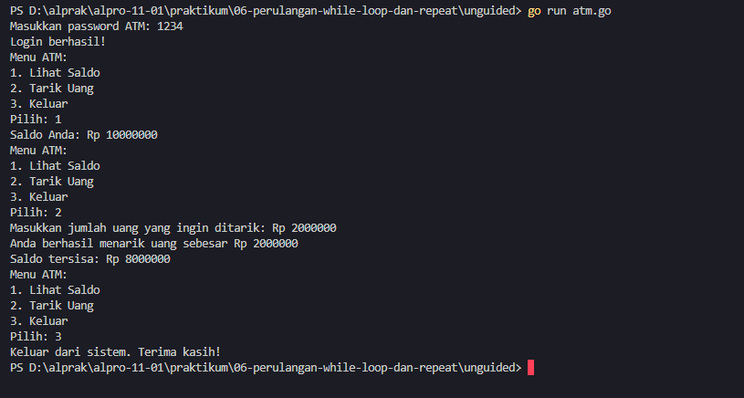
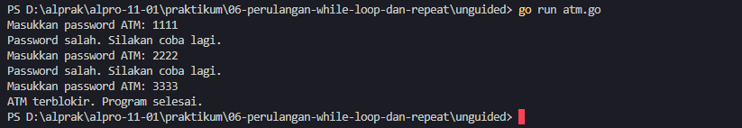

<h1 align="center">Laporan Praktikum Modul 06 - Perulangan While</h1>
<p align="center">Mirza Ukail Falah Triyarso - 109092600006</p>

## Dasar Teori

### 1. Konsep Perulangan Berbasis Kondisi (While-Loop)

Perulangan *while* merupakan struktur kontrol alur program yang digunakan untuk mengeksekusi sekumpulan instruksi secara berulang selama suatu kondisi logika (*boolean expression*) tertentu terpenuhi atau bernilai `true`. Karakteristik utama dari *while-loop* terletak pada mekanisme pengujian kondisinya yang dilakukan di awal blok perulangan (*pre-test loop*).

Proses eksekusi *while-loop* mengikuti langkah-langkah berikut:
1. Program mengevaluasi ekspresi kondisi yang didefinisikan.
2. Jika kondisi bernilai `true`, maka seluruh instruksi di dalam blok perulangan akan dieksekusi.
3. Setelah eksekusi instruksi selesai, alur program kembali ke titik awal untuk melakukan re-evaluasi kondisi.
4. Jika pada saat evaluasi kondisi bernilai `false`, perulangan langsung dihentikan dan eksekusi dilanjutkan ke baris kode setelah blok perulangan.

Notasi *pseudocode* dasar untuk perulangan *while* secara umum dapat dituliskan sebagai berikut:
```text
while (kondisi_logika) do
    // blok instruksi yang dieksekusi
endwhile
```

### 2. Implementasi Equivalent While pada Bahasa Go (Golang)

Berbeda dengan sebagian besar bahasa pemrograman imperatif seperti C, Java, atau Python, Golang **tidak memiliki** kata kunci khusus `while` maupun `do-while`. Pendesain bahasa Go memilih pendekatan minimalis dengan mengonsolidasikan seluruh jenis mekanisme perulangan hanya melalui satu kata kunci, yaitu `for`.

Untuk menerapkan konsep *while-loop* di Golang, kita menggunakan sintaks `for` yang hanya menerima satu parameter berupa ekspresi kondisi (sering disebut sebagai *single-condition loop*):
```go
i := 1
for i <= 5 {
    // blok instruksi yang dieksekusi selama i <= 5
    i++
}
```

Pada bentuk sintaks di atas, `for i <= 5` secara fungsional bekerja identik dengan `while (i <= 5)`.

### 3. Komponen Utama dan Bahaya Infinite Loop

Dalam merancang perulangan berbasis kondisi, terdapat tiga komponen vital yang harus diperhatikan:
1. **Inisialisasi Variabel Kontrol**: Menentukan nilai awal variabel sebelum perulangan dimulai.
2. **Kondisi Berhenti (*Termination Condition*)**: Ekspresi boolean yang menentukan kapan perulangan harus terus berjalan atau berhenti.
3. **Pembaruan Variabel Kontrol (*State Update*)**: Perubahan nilai variabel di dalam blok perulangan (misalnya *increment* `i++` atau *decrement* `i--`) agar perulangan dapat mencapai kondisi akhir (*false*).

Jika pembaruan nilai variabel kontrol terlewatkan atau kondisi berhenti tidak pernah terpenuhi, program akan mengalami **Infinite Loop** (perulangan tanpa henti). Kondisi ini dapat menyebabkan konsumsi resource CPU membengkak hingga program mengalami kebuntuan (*hang/crash*).

---

## Guided

### 1. terkecil.go
```go
package main
import "fmt"

func main() {
    var batas int
    fmt.Scan(&batas)

    n := 1
    for n*n*n <= batas {
        n++
    }

    fmt.Println(n)
}
```

#### Deskripsi
Program `terkecil.go` bertujuan untuk mengidentifikasi nilai bulat terkecil `n` sedemikian rupa sehingga pemangkatan tiga dari variabel tersebut ($n^3$) bernilai lebih besar dari input `batas` yang diberikan pengguna. Perulangan `for` akan terus menaikkan nilai `n` satu per satu (*increment*) selama $n^3$ masih kurang dari atau sama dengan `batas`. Begitu nilai $n^3$ melampaui `batas`, perulangan terhenti dan nilai `n` terbaru dicetak ke layar.

### 2. terbesar.go
```go
package main
import "fmt"

func main() {
    var batas int
    fmt.Scan(&batas)

    n := 1
    for n*n < batas {
        n++
    } 

    fmt.Println(n - 1)
}
```

#### Deskripsi
Program `terbesar.go` dirancang untuk mencari bilangan bulat positif terbesar `n` yang hasil kuadratnya ($n^2$) tetap bernilai lebih kecil dari `batas`. Di dalam perulangan, nilai `n` terus ditambah selama $n^2 < batas$. Ketika perulangan terhenti (karena $n^2$ telah mencapai atau melebihi `batas`), nilai `n` saat itu sudah melewati kriteria, sehingga program mencetak `n - 1` untuk mendapatkan nilai bulat terakhir yang memenuhi syarat.

### 3. vokal.go
```go
package main

import (
    "bufio"
    "fmt"
    "os"
    "strings"
)

func main() {
    reader := bufio.NewReader(os.Stdin)
    kalimat, _ := reader.ReadString('\n')

    i := 0
    jumlahVokal := 0

    for i < len(kalimat) {
        ch := strings.ToLower(string(kalimat[i]))
        if ch == "a" || ch == "i" || ch == "u" || ch == "e" || ch == "o" {
            jumlahVokal++
        }
        i++
    }

    fmt.Println(jumlahVokal)
}
```

#### Deskripsi
Program `vokal.go` melakukan analisis terhadap sebuah string masukan untuk menghitung total akumulasi karakter vokal (`a`, `i`, `u`, `e`, `o`). Pembacaan input memanfaatkan `bufio.NewReader` agar mampu menerima string yang mengandung spasi. Perulangan berjalan berdasarkan indeks karakter dari `0` hingga panjang string (`len(kalimat)`). Setiap karakter dikonversi terlebih dahulu menjadi huruf kecil menggunakan `strings.ToLower` untuk memastikan pemeriksaan tidak bersifat *case-sensitive*, lalu variabel `jumlahVokal` di-increment jika karakter tersebut cocok dengan salah satu huruf vokal.

---

## Unguided

### 1. atm.go
```go
package main

import "fmt"

func main() {
	// Inisialisasi data
	correctPassword := "1234"
	saldo := 10000000
	
	var password string
	var attempts int = 0
	var isLoggedIn bool = false

	// Proses login (maksimal 3 kesempatan)
	for attempts < 3 && !isLoggedIn {
		fmt.Print("Masukkan password ATM: ")
		fmt.Scan(&password)

		if password == correctPassword {
			isLoggedIn = true
			fmt.Println("Login berhasil!")
		} else {
			attempts++
			if attempts < 3 {
				fmt.Println("Password salah. Silakan coba lagi.")
			}
		}
	}

	// Jika salah 3 kali berturut-turut, ATM terblokir
	if !isLoggedIn {
		fmt.Println("ATM terblokir. Program selesai.")
		return
	}

	// Menu ATM (berulang selama pengguna belum memilih keluar)
	var pilihan int
	for {
		fmt.Println("Menu ATM:")
		fmt.Println("1. Lihat Saldo")
		fmt.Println("2. Tarik Uang")
		fmt.Println("3. Keluar")
		fmt.Print("Pilih: ")
		fmt.Scan(&pilihan)

		if pilihan == 1 {
			fmt.Printf("Saldo Anda: Rp %d\n", saldo)
		} else if pilihan == 2 {
			var tarik int
			fmt.Print("Masukkan jumlah uang yang ingin ditarik: Rp ")
			fmt.Scan(&tarik)

			if tarik <= saldo {
				saldo -= tarik
				fmt.Printf("Anda berhasil menarik uang sebesar Rp %d\n", tarik)
				fmt.Printf("Saldo tersisa: Rp %d\n", saldo)
			} else {
				fmt.Println("Saldo tidak mencukupi.")
			}
		} else if pilihan == 3 {
			fmt.Println("Keluar dari sistem. Terima kasih!")
			break
		} else {
			fmt.Println("Pilihan tidak valid. Silakan coba lagi.")
		}
	}
}
```

#### Output


#### Output Ketika Salah

#### Deskripsi
`atm.go` merupakan program aplikasi perbankan sederhana yang mensimulasikan mekanisme keamanan dan transaksi pada mesin ATM. Program ini menggunakan kombinasi dua jenis perulangan `for` (berkondisi ganda dan perulangan tak terbatas dengan pembatas `break`).

Mekanisme kerja program terbagi menjadi dua tahapan utama:

1. **Autentikasi Pengguna (Login)**
   - Pengguna diberi kesempatan maksimum 3 kali (`attempts < 3`) untuk memasukkan kata sandi.
   - Variabel boolean `isLoggedIn` digunakan sebagai indikator status akses pengguna.
   - Jika pengguna memasukkan sandi yang cocok (`"1234"`), `isLoggedIn` diubah menjadi `true` sehingga perulangan login berhenti dan program memberikan pesan konfirmasi.
   - Apabila percobaan mencapai 3 kali dan password tetap salah, sistem mencetak pesan kegagalan dan mengeksekusi `return` untuk menghentikan program (simulasi ATM terblokir).

2. **Menu Transaksi Utama**
   - Setelah login berhasil, program memasuki perulangan `for` tanpa kondisi (*infinite loop*) untuk menyajikan menu perbankan secara interaktif hingga pengguna memilih opsi keluar.

#### Fitur Menu ATM:
* **1. Lihat Saldo**: Menampilkan besaran saldo akun saat ini yang diinisialisasi sebesar `10000000`.
* **2. Tarik Uang**: Mengambil input jumlah penarikan `tarik`. Program mengevaluasi kecukupan saldo dengan pengondisian `tarik <= saldo`. Jika memenuhi, saldo akan berkurang sebesar nominal penarikan (`saldo -= tarik`) dan saldo terbaru akan ditampilkan. Jika nominal melebih saldo, program menampilkan pesan peringatan `"Saldo tidak mencukupi."`.
* **3. Keluar**: Menampilkan ucapan terima kasih dan mengeksekusi perintah `break` untuk memutus perulangan menu utama serta mengakhiri program.
* **Opsi Lain**: Mengani penanganan input yang tidak valid jika pengguna memilih angka selain 1, 2, atau 3.

---

## Kesimpulan
Melalui praktikum Modul 06 ini, dapat disimpulkan bahwa bahasa Go menyederhanakan mekanisme perulangan dengan mengonsolidasikan seluruh fungsi *looping* hanya melalui kata kunci `for`. Konsep perulangan *while* (berbasis kondisi) di Go diimplementasikan dengan memberikan ekspresi kondisi tunggal pada instruksi `for`. Pola perulangan ini sangat efektif digunakan pada kasus-kasus program yang tidak dapat diprediksi jumlah iterasi pastinya secara pasti di awal (seperti validasi login, pembacaan string karakter per karakter, hingga pemrosesan menu navigasi interaktif).

---

## Referensi
1. Modul 06 Praktikum Algoritma dan Pemrograman - *Perulangan While*.
2. Dokumentasi Resmi Bahasa Pemrograman Go (Golang) - *For statements*.